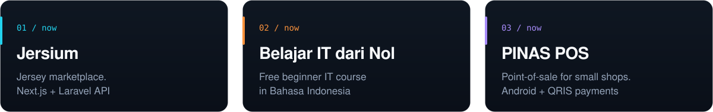

<a href="https://muhammadrapi.vercel.app">Portfolio</a> &nbsp;/&nbsp;
<a href="https://www.linkedin.com/in/muhammad-rafi-1053aa311/">LinkedIn</a> &nbsp;/&nbsp;
<a href="mailto:muhammadrafi62166@gmail.com">Email</a> &nbsp;/&nbsp;
<a href="https://instagram.com/m.raapiii">Instagram</a>

### Working on

### Shipped

- **[pinas-pos-android](https://github.com/muhammad-rapi/pinas-pos-android)** - POS app for shop counters. `Java`
- **[pinas-pos-qris](https://github.com/muhammad-rapi/pinas-pos-qris)** - QRIS payment page for PINAS POS. `HTML`
- **[mimosa-hyundai](https://github.com/muhammad-rapi/mimosa-hyundai)** - Website for an authorized Hyundai dealer in Medan. `HTML`
- **[ps-rental](https://github.com/muhammad-rapi/ps-rental)** - Rental and billing for a PlayStation shop. `PHP`
- **[belajar-it-course](https://github.com/muhammad-rapi/belajar-it-course)** - The open course behind Belajar IT dari Nol. `Markdown`

### Stack

